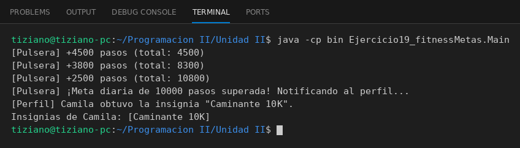

# PulseraInteligente

Programación II - Unidad 2 - Ejercicio 19

## Consigna
Una pulsera notifica a un perfil de usuario cuando se supera la meta diaria de pasos.

## Lógica
- `PerfilUsuario`: nombre, pasos acumulados e insignias; `otorgarInsignia` evita duplicados.
- `PulseraInteligente.registrarPasos(cantidad)`: suma los pasos al perfil y, en el momento exacto en que se cruza la meta de 10000, envía el mensaje para otorgar la insignia "Caminante 10K".
- `Main`: tres registros de pasos y verificación de la insignia.

## Ejecución

